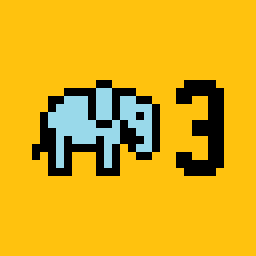

  

<h1 align="center">slon3studio</h1>

  Majhen studio. Velike ideje. 
  Preproste, uporabne aplikacije za iPhone, Mac in splet.

  <a href="https://slon3studio.si/"><b>Obišči spletno stran</b></a>
  &nbsp;·&nbsp;
  <a href="https://slon3studio.si/pages/projects.html">Aplikacije</a>
  &nbsp;·&nbsp;
  <a href="https://slon3studio.si/pages/contact.html#work">Naroči aplikacijo</a>

---

## O strani

To je uradna spletna stran studia slon3studio. Na njej:

- predstavimo studio in vse naše aplikacije,
- ima vsaka aplikacija svojo stran s pregledom, podporo (Support) in politiko
  zasebnosti (Privacy Policy),
- lahko stranke prek obrazca »Build my app« pošljejo povpraševanje za izdelavo aplikacije.

Vsebina strani je v angleščini.

## O studiu

slon3studio je samostojni studio za razvoj aplikacij iz Slovenije. Izdelujemo aplikacije za iPhone in Mac, predvsem s SwiftUI in
Applovimi ogrodji, ter spletne aplikacije.

- **Domače aplikacije:** narejene z Applovimi orodji, zato so hitre in se na napravi obnašajo, kot pričakuješ.
- **Zasebnost na prvem mestu:** zbiramo samo, kar aplikacija res potrebuje.
- **Prava podpora:** vprašanja gredo naravnost k razvijalcu, ki je aplikacijo
  naredil.

Aplikacije izdelujemo tudi po naročilu, za posameznike in manjša podjetja.

## Naši produkti

<table>
  <tr>
    <td width="96" align="center">
      
    </td>
    <td>
      <b><a href="https://slon3studio.si/pages/MouseController/MouseController.html">Mouse Controller</a></b> · <a href="https://apps.apple.com/si/app/mousecontroller/id6766896246">App Store</a> 
      iPhone spremeni v brezžično sledilno ploščico in tipkovnico za Mac. 
      iOS · macOS · SwiftUI
    </td>
  </tr>
  <tr>
    <td width="96" align="center">
      
    </td>
    <td>
      <b><a href="https://slon3studio.si/pages/PayDay/PayDay.html">PayDay</a></b> · <a href="https://apps.apple.com/us/app/payday-shift-tracker/id6819828248">App Store</a> 
      Beleži izmene, napitnine in plačo pri več službah ter pokaže, koliko bo izplačilo ta mesec. 
      iOS · SwiftUI · iCloud
    </td>
  </tr>
  <tr>
    <td width="96" align="center">
      
    </td>
    <td>
      <b><a href="https://slon3studio.si/pages/Rotera/Rotera.html">Rotera</a></b> 
      Urnik izmen za vsako ekipo: vodja sestavi teden, zaposleni pošljejo želje, menjave in zamenjave izmen pa gredo vodji v potrditev. Aplikacija za iPhone, za Android pa <a href="https://rotera.slon3studio.si">spletna aplikacija</a>. 
      iOS · spletna aplikacija
    </td>
  </tr>
  <tr>
    <td width="96" align="center">
      
    </td>
    <td>
      <b><a href="https://slon3studio.si/pages/Slippy/Slippy.html">Slippy</a></b> 
      Kalkulator za natakarje in blagajnike: s kamero prebere znesek na kartičnih slipih in jih ob koncu izmene sešteje. 
      iOS · SwiftUI · Vision
    </td>
  </tr>
  <tr>
    <td width="96" align="center">
      
    </td>
    <td>
      <b><a href="https://slon3studio.si/pages/Tacka/Tacka.html">Tačka</a></b> 
      Poišči zaupanja vrednega sprehajalca psov ali varuha v bližini in spremljaj vsak sprehod v živo na zemljevidu. 
      iOS · SwiftUI · MapKit
    </td>
  </tr>
</table>

Nove aplikacije so že v delu.

## Dostop

- **Spletna stran:** <https://slon3studio.si/>
- **Lokalno:** v mapi zaženi `python3 -m http.server` in odpri <http://localhost:8000>. Povezave Home kažejo na mapo (`./`), zato jih strežnik odpre kot `index.html`.

## Kontakt

  <a href="mailto:slon3studio@gmail.com">slon3studio@gmail.com</a>
  &nbsp;·&nbsp;
  <a href="https://github.com/slon3studio">GitHub</a>

